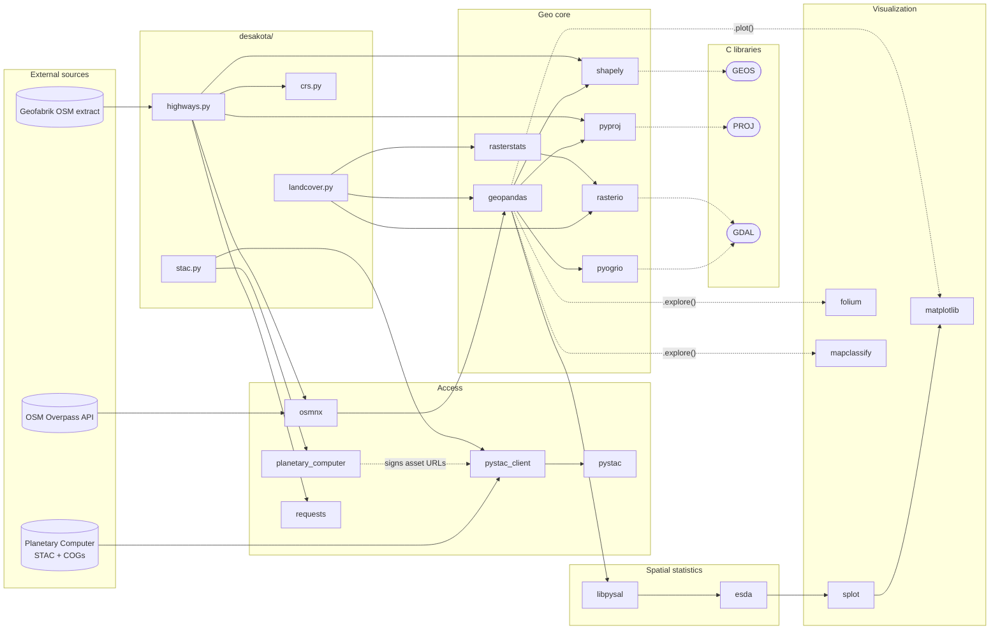

# desakota

Does building along Vietnam's national highways create *desakota*, McGee's
term for scattered, mixed town-and-farm growth, instead of compact cities?
This notebook project tests that along one road first: the QL18 corridor, from
Bắc Ninh through Chí Linh and Quảng Ninh to Móng Cái.

The working question: **is there ribbon development along QL18, and how serious
is it?**

The method follows Verbeek et al. (2014). First find the strips of buildings
along roads ("ribbons"), then measure their length per km², then run spatial
statistics (ESDA) on that. `CLAUDE.md` has the scope and the conventions.

## Quick start

Needs Linux or WSL (Ubuntu 24.04), `git`, `curl`, `unzip` and
[uv](https://docs.astral.sh/uv/getting-started/installation/).

```bash
git clone https://github.com/Nguyen-H-Bang-29/desakota.git ~/projects/desakota && cd ~/projects/desakota
uv sync                  # installs Python 3.14 and every dependency into .venv
uv run pytest            # 91 tests, offline, about 30 s

# The one input not in git: the Geofabrik OSM extract for Vietnam (1.4 GB unzipped)
curl -L -o /tmp/vietnam-free.gpkg.zip \
  https://download.geofabrik.de/asia/vietnam-latest-free.gpkg.zip
unzip -o /tmp/vietnam-free.gpkg.zip -d data/raw/osm/geofabrik_vietnam-261016

uv run jupyter lab       # then run the notebooks in number order
```

Keep the folder name `geofabrik_vietnam-261016` even though your download is
newer, because notebook 01 reads that exact path. "Latest" changes every day,
so you get roads as of your download date, not the 2026-10-16 snapshot recorded
in `data/raw/osm/geofabrik_vietnam-261016.json`. If road counts differ from the
committed notebook output, that is the reason.

## Pipeline

| Step | Reads | Writes (`data/processed/`) |
|---|---|---|
| `01_preparation` | GADM communes, Geofabrik extract, 10 m LULC clip (searches Planetary Computer, so needs internet) | `communes_ql18_corridor.gpkg`: communes within 2 km of QL18 (the study area), with `dist_to_ql18_m`, `is_crossed_by_ql18`, `built_frac` |
| `02_esda` | `communes_ql18_corridor.gpkg` | nothing. Moran's I / LISA per commune (Queen, island attached by KNN-1). **Superseded as a method**: on the whole delta it found city cores, not corridors |
| `03_hexagons` | `communes_ql18_corridor.gpkg`, `highways_ql18.gpkg`, the cached LULC clip | `hexes_built_frac_h3r{8,9,10}.gpkg` (built_frac, dist_to_ql18_m per H3 cell over the 2 km band) and `hexes_lisa_built_frac_h3r9.gpkg` (plus LISA quadrant and pseudo p) |
| `04_corridor_width` | `highways_ql18.gpkg`, GADM communes, a wider LULC clip (downloaded on first run) | nothing. LISA on H3 res 8 for bands of 2/3/5/8 km, and how much High-High area reaches the band edge |

All files are in EPSG:32648 (UTM 48N).

## Attempts so far

This is a learning project, so the superseded notebooks stay in, in the order
they were tried. Each records what it found and why the next one followed. Read
them as a sequence of attempts, not as one pipeline.

| # | Notebook | Unit and method | What it showed | Why the next attempt |
|---|---|---|---|---|
| 1 | `02_esda` | Communes (~2.4 km); Moran's I / LISA on `built_frac` | Strong clustering (I = 0.75 on the delta), but High-High = city cores | A ribbon a few hundred metres wide disappears inside a commune |
| 2 | `03_hexagons` | H3 res 8/9/10 over the 2 km band; distance decay, LISA | Built share falls steadily with distance from QL18; LISA still finds towns, and most High-High area reaches the band edge | A patch cut off by the band edge looks elongated along the road, exactly like a ribbon |
| 3 | `04_corridor_width` | H3 res 8, bands of 2–8 km; patches with alpha-shape elongation and road measures | Patches don't stop at 8 km (the Bắc Ninh–Đông Triều fabric is wider than 16 km); elongation can't separate a ribbon from a branching web; relating patches to the road gives a stable 62 km² of ribbon candidates | Next: compare the road frontage with the land behind it |

## Data in git

Only `data/raw/` inputs that the notebooks read are committed (23 MB). `interim/`
and `processed/` are rebuilt by running the notebooks, so they are never
committed. `.gitignore` lists the raw files one by one, so a new raw file is
ignored until you add it there.

| File | Used by | Source |
|---|---|---|
| `raw/gadm41_VNM_3.json` | 01 | [GADM 4.1](https://gadm.org/download_country.html), Vietnam level 3 (communes), EPSG:4326 |
| `raw/lulc/lulc_48Q-2023_3d7e0d2660ca.tif` + `.json` | 01 | `fetch_landcover` cache of Impact Observatory 10 m LULC 2023, clipped to the corridor |
| `raw/lulc/lulc_48Q-2023_fa4b43a451f3.tif` + `.json` | 04 | Same source, wider window: the 8 km band either side of QL18 (5 MB) |
| `raw/osm/geofabrik_vietnam-261016.json`, `…/README` | 01 | Provenance of the Geofabrik extract. The `.gpkg` itself is downloaded by hand (see Quick start) |

Files from earlier phases that nothing reads any more (the pre-fetcher
`landuse.tif`, the 9-province LULC clip, GADM districts, the Overpass cache,
textbook practice data) were moved out of the repo to `~/data/desakota-legacy`
on the author's machine on 2026-10-25. They were never committed.

## Setup details

**Where to put the repo.** Clone it onto the WSL filesystem (`~/projects/...`).
Under `/mnt/c` every file access goes through 9P, which is about 10x slower
([Microsoft docs](https://learn.microsoft.com/windows/wsl/filesystems#file-storage-and-performance-across-file-systems)).
Installs feel it most: uv cannot hardlink from its ext4 cache into a `/mnt/c`
venv, so it copies every file (measured: 5 m 38 s for 2 packages). If the repo
has to stay on `/mnt/c`, keep the venv on ext4 and symlink it in. The sync then
takes seconds, and `.venv` stays where uv and VS Code expect it:

```bash
UV_PROJECT_ENVIRONMENT=~/.venvs/desakota uv sync   # build the venv on ext4 (about 3 s)
rm -rf .venv && ln -s ~/.venvs/desakota .venv       # uv and VS Code follow the link
```

The data tree can move too: `export DESAKOTA_DATA_DIR=~/data/desakota` in your
shell profile. Nothing reads `.env`; `.env.example` only lists the variables.

**uv on PATH.** The installer puts uv in `~/.local/bin`. If `uv` is not found,
add `export PATH="$HOME/.local/bin:$PATH"` to your profile.

**Create the venv from Linux.** A venv made from Windows has a different layout
and won't work in WSL.

**VS Code.** Open the folder from WSL (`code .`) and install the recommended
extensions (Ruff, Python). Pylance is turned off on purpose. Type checking is
`uv run pyright` in strict mode, see [Checks](#checks).

## Layout

```
desakota/           Importable support code, typed and tested
  paths.py            Data-tree layout (DataLayout)
  crs.py              Named CRS constants (WGS84 / UTM 48N / equal-area)
  stac.py             Planetary Computer STAC client + LULC collection search
  landcover.py        LULC window clip (cached) + built-up fraction per polygon
  highways.py         OSM roads (Geofabrik reader, Overpass fetcher) + route tiers
notebooks/          Exploratory notebooks, numbered in reading order
tests/              pytest (never touches the network)
data/
  raw/                Source data as downloaded. Only fetchers write here, once
  interim/            Intermediates, rebuildable from raw/
  processed/          Analysis-ready outputs, rebuildable from raw/
```

## Libraries

### Which tool for what

Start here when you need to do something and don't know what to reach for.
**Status** says whether it is ready to use:

- **declared**: in `pyproject.toml`, import it freely.
- **transitive**: already importable because another package pulls it in, but not
  declared. Fine in a notebook. Run `uv add` before importing it from `desakota/`,
  or an upstream release can quietly remove it.
- **add**: not installed. `uv add` it when the analysis actually needs it.
- **deferred**: out of scope for the current phase (see `CLAUDE.md`).

| Need | Reach for | Entry point | Status |
|---|---|---|---|
| **Getting data** | | | |
| Search satellite / LULC catalogues | `pystac-client` + `planetary-computer` | `desakota.stac.search_items` | declared |
| OSM roads or other tagged features | `osmnx` | `desakota.highways.load_highways` (Geofabrik extract), `fetch_highways` (Overpass) | declared |
| Plain HTTP (status checks, small APIs) | `requests` | `requests.get(..., timeout=)` | declared |
| Building footprints | Microsoft `ms-buildings` (via STAC) | — | deferred |
| **Vector data** | | | |
| Read/write GeoPackage, GeoJSON, Parquet | `geopandas` + `pyogrio` | `gpd.read_file`, `.to_file`, `.to_parquet` | declared |
| Reproject a layer | `geopandas` | `.to_crs(CRS_EQUAL_AREA)` (constants in `desakota.crs`) | declared |
| Reproject a bare geometry or coordinates | `pyproj` | `Transformer.from_crs(..., always_xy=True)` | declared |
| Buffer, union, simplify, predicates | `shapely` 2 | `shapely.buffer`, `shapely.union_all`, `.intersects` (vectorized) | declared |
| Spatial join / overlay | `geopandas` | `gpd.sjoin`, `gpd.overlay` | declared |
| Distance from each feature to the nearest road | `geopandas` | `gpd.sjoin_nearest(..., distance_col='dist_m')` | declared |
| Shape elongation of a patch | `shapely` 2 | `shapely.oriented_envelope` → long side / short side | declared |
| Ready-made shape and urban-form metrics | `momepy` | `momepy.elongation`, `momepy.morphological_tessellation` | add |
| Regular analysis grid (MAUP check) | `shapely` + `numpy` | `shapely.box` over a `numpy` meshgrid | declared |
| Hexagonal grid | `h3` | `h3.geo_to_cells` | add |
| SQL on big vector tables, out of memory | `duckdb` + spatial extension | `INSTALL spatial; LOAD spatial;` | add |
| **Raster data** | | | |
| Read only the AOI from a remote COG | `rasterio` | `desakota.landcover.fetch_landcover`, `rasterio.windows.from_bounds` | declared |
| Pixel counts / stats per polygon | `rasterstats` | `zonal_stats(..., categorical=True)` | declared |
| Raster algebra with labelled axes | `rioxarray` / `xarray` | `rioxarray.open_rasterio(...).rio.clip_box` | add |
| Raster → polygons | `rasterio` | `rasterio.features.shapes` | declared |
| Polygons/lines → raster mask | `rasterio` | `rasterio.features.rasterize`, `geometry_mask` | declared |
| Reproject or resample a raster | `rasterio` | `rasterio.warp.reproject` (`Resampling.nearest` for classes) | declared |
| Connected built-up clusters | `scipy` | `scipy.ndimage.label` | transitive |
| Grow/shrink a mask by N pixels | `scipy` | `scipy.ndimage.binary_dilation` / `binary_erosion` | transitive |
| Distance from every pixel to a road | `scipy` | `distance_transform_edt` on a rasterized road mask | transitive |
| Per-cluster shape (axis lengths, eccentricity) | `scikit-image` | `skimage.measure.regionprops` | add |
| **Spatial statistics** | | | |
| Spatial weights (who counts as a neighbour) | `libpysal` | `weights.Queen`, `weights.KNN`, `weights.DistanceBand` | declared |
| Global autocorrelation | `esda` | `esda.Moran`, `esda.Geary` | declared |
| Local clusters / hot spots | `esda` | `esda.Moran_Local`, `esda.G_Local` (Getis-Ord Gi*) | declared |
| Autocorrelation of a yes/no map (ribbon or not) | `esda` | `esda.Join_Counts` | declared |
| Choropleth class breaks | `mapclassify` | `FisherJenks`, `Quantiles` (or `.plot(scheme=...)`) | declared |
| Spatial regression (lag / error models) | `spreg` | `spreg.OLS`, `spreg.ML_Lag`, `spreg.ML_Error` | transitive |
| Clustering of points (non-spatial-weights) | `scikit-learn` | `sklearn.cluster.DBSCAN` | transitive |
| Point-pattern tests (Ripley's K, quadrats) | `pointpats` | `pointpats.k_test` | add |
| **Visualization** | | | |
| Quick static map | `geopandas` → `matplotlib` | `.plot(column=..., legend=True)` | declared |
| Interactive map | `geopandas` → `folium` | `.explore(column=...)` | declared |
| Basemap tiles under a static map | `contextily` | `cx.add_basemap(ax, crs=layer.crs)` | add |
| Moran scatterplot, LISA cluster map | `splot` | `splot.esda.moran_scatterplot`, `lisa_cluster` | declared |
| Distributions and relationships (e.g. ribbons vs distance) | `seaborn` | `histplot`, `boxplot`, `regplot` | transitive |
| Raster preview | `rasterio` | `rasterio.plot.show` | declared |
| Interactive map of 100k+ features | `lonboard` | `lonboard.viz(layer)` | add |
| **Networks** | | | |
| Routing, isochrones, network distance | `osmnx` graphs + `networkx` | `ox.graph_from_polygon` | deferred |
| **Tooling** | | | |
| Readable console tables and progress bars | `rich` | `rich.table.Table`, `rich.progress.track` | add |
| Format, lint, types, tests | `ruff`, `pyright`, `pytest` | see [Checks](#checks) | declared (dev) |

Each choice above is a default, and these trade-offs explain the less obvious ones:

- **`scipy.ndimage` vs `scikit-image`.** `ndimage.label` and morphology are enough
  to find clusters and buffer them by pixels. Add `scikit-image` once you need
  per-cluster geometry (`regionprops` gives orientation and major/minor axis
  lengths, which is the raster form of Verbeek's elongation test).
- **`oriented_envelope` vs `momepy`.** For a few thousand patches, one shapely
  call gives the long/short side ratio. `momepy` earns its install when you want
  several morphometrics at once, with definitions from the literature (Fleischmann
  2019, *JOSS* 4(43):1807).
- **`esda.G_Local` vs `Moran_Local`.** Getis-Ord Gi* (Getis & Ord 1992) only flags
  high and low concentrations. LISA (Anselin 1995) also separates spatial
  outliers (High-Low, Low-High), and a lone ribbon in farmland is exactly that.
- **Nearest-neighbour resampling for LULC.** Any other method averages class ids
  into classes that don't exist (Built 7 next to Water 1 gives 4, "Flooded vegetation").

### Dependency map

How the dependencies fit together, from external source to figure. Solid edges are
direct imports in `desakota/` or the notebooks; dotted edges are runtime
dependencies pulled in by another library (you never import them yourself).



### Roles

| Layer | Library | Role here | Used in |
|---|---|---|---|
| Access | `pystac-client`, `pystac` | Search the 10 m annual LULC collection by bbox (WGS 84) and year; returns STAC items whose assets are COGs | `stac.py`, `landcover.py` |
| | `planetary-computer` | `sign_inplace` modifier: appends short-lived SAS tokens to asset hrefs so rasterio can read them | `stac.py` |
| | `osmnx` | `features_from_polygon` only — raw OSM ways with original tags, never a routing graph (see Highways) | `highways.py` |
| | `requests` | `ConnectionError` is what the Overpass retry/backoff loop catches | `highways.py` |
| Geo core | `geopandas` | The table every vector layer lives in (communes, AOI, roads); `sjoin`, `dissolve`, `to_crs` | everywhere |
| | `shapely` 2 | Vectorized geometry ops (buffer, simplify, union) over GEOS | `highways.py` |
| | `pyproj` | CRS objects and `Transformer(always_xy=True)` for bare geometries (Overpass polygon) over PROJ | `highways.py`, `crs.py` |
| | `pyogrio` | geopandas' I/O engine: GeoPackage read/write via GDAL's OGR, vectorized (much faster than fiona) | via geopandas |
| | `rasterio` | Windowed, pixel-snapped read of the AOI from the remote COG (each item is a whole UTM-zone x latitude-band mosaic, so never read in full); CRS/extent checks before zonal stats | `landcover.py` |
| | `rasterstats` | `zonal_stats(categorical=True)`: pixel counts per class per polygon → built-up fraction | `landcover.py` |
| Statistics | `libpysal` | Spatial weights (Queen contiguity, row-standardized) — defines what "neighbour" means | 02 |
| | `esda` | Global Moran's I and local Moran (LISA, Anselin 1995) with permutation inference | 02 |
| Visualization | `splot` | Moran scatterplot and LISA cluster map, paired with every ESDA result | 02 |
| | `matplotlib` | Backend for `GeoDataFrame.plot()` and splot | all notebooks |
| | `folium`, `mapclassify` | Backend for `GeoDataFrame.explore()` (Leaflet map; mapclassify supplies the classification scheme) | ad hoc |
| Tooling | `ipython`, `jupyterlab`, `ipykernel` | Notebook runtime | — |
| | `ruff`, `pyright`, `pytest`, `pandas-stubs`, `types-shapely`, `types-requests` | Lint/format, strict typing, tests (network stubbed) | dev |

Three C libraries do the real work underneath: **GEOS** (geometry predicates and
overlays, behind shapely), **PROJ** (datum/projection math, behind pyproj and,
through it, geopandas and rasterio), and **GDAL** (raster and vector drivers, behind
rasterio and pyogrio). Wheels bundle their own copies of PROJ and GDAL, so rasterio
and pyogrio can carry different GDAL versions — usually harmless, but it is the
first place to look if a format or CRS behaves differently between the two.

The data flow in the current notebooks: Geofabrik centrelines read by
`load_highways` and tiered by `ref` pick out QL18 and its 2 km corridor (01) →
`stac` finds the LULC item → `rasterio` clips its window to `raw/lulc/` →
`rasterstats` reduces it to built-up fraction per corridor commune (01) →
`libpysal` weights + `esda` Moran/LISA + `splot` plots on that table (02, a
baseline). Ribbon detection, which replaces 02 as the method, comes next.

## Highways (`desakota.highways`)

Fetches OpenStreetMap road centrelines for an area of interest (AOI) and labels
each way as expressway / national / provincial / other.

### Quick start

Since 2026-10 the public Overpass server refuses scripts, so roads come from a
local Geofabrik extract. The top-level [Quick start](#quick-start) shows how to
download it (740 MB zip). If you deliberately switch to a new snapshot, unzip it
into `raw/osm/geofabrik_vietnam-<yymmdd>/`, copy the OSM timestamp from its
README into a matching `.json` sidecar, and update the path in notebook 01 and
`.gitignore`.

```python
import geopandas as gpd

from desakota.highways import add_route_tier, load_highways
from desakota.paths import DataLayout

layout = DataLayout.from_env().ensure()
communes = gpd.read_file(layout.processed / 'communes_ql18_corridor.gpkg')  # EPSG:32648

extract_path = layout.raw / 'osm' / 'geofabrik_vietnam-261016' / 'vietnam.gpkg'
highways = add_route_tier(load_highways(extract_path, communes))  # EPSG:32648
highways.plot(column='tier', legend=True)
```

Reading Bắc Ninh + Hải Dương + Quảng Ninh + Sóc Sơn takes about 80 s with the extract on
`/mnt/c` (the 1.4 GB GeoPackage is read through 9P); put it on ext4 via
`DESAKOTA_DATA_DIR` if that matters. `fetch_highways` (Overpass) is kept for a
private Overpass instance; with the public one it will exhaust its retries.

### Functions

| Function | Returns | Use it to |
|---|---|---|
| `fetch_highways(aoi, *, cache_dir, highway_classes=('motorway', 'trunk', 'primary'), buffer_m=2000, force=False, max_attempts=12, overpass_url=DEFAULT_OVERPASS_URL)` | `GeoDataFrame`, EPSG:32648, line geometries | Get road centrelines. Cached; refetches only if the AOI, buffer or classes change, or with `force=True`. |
| `load_highways(gpkg_path, aoi, *, highway_classes=('motorway', 'trunk', 'primary'), buffer_m=2000)` | Same as `fetch_highways` | Read road centrelines from a Geofabrik free GeoPackage (layer `GEOFABRIK_ROADS_LAYER`). No network, no cache needed. `lanes` is always NA; `oneway` is NA for two-way *and* untagged roads, which the export cannot tell apart. |
| `add_route_tier(highways)` | Copy with `tier` and `route` columns | Label ways. Needs the `ref` and `name` columns, i.e. the output of `load_highways` or `fetch_highways`. |
| `compute_is_on_route(highways, route)` | Boolean `Series` aligned to `highways` | Select one national route, e.g. `'QL18'`. Checks every number in `ref` (`route` keeps only the first, so `QL.17;QL.18` would be missed). Includes co-signed expressway sections; add `& (highways['tier'] == 'national')` for the frontage road. |
| `build_query_polygon(aoi, *, buffer_m=2000, simplify_tol_m=250)` | WGS 84 `Polygon` or `MultiPolygon` (lon, lat) | Inspect exactly what is sent to Overpass. `fetch_highways` calls it for you. |

Constants: `DEFAULT_HIGHWAY_CLASSES`, `KEEP_COLUMNS`, `GEOFABRIK_ROADS_LAYER`, `DEFAULT_OVERPASS_URL`. CRS
constants live in `desakota.crs`: `CRS_WGS84` (EPSG:4326), `CRS_UTM` (EPSG:32648,
working CRS), `CRS_EQUAL_AREA` (EPSG:6933).

`aoi` must be a `GeoDataFrame` in a projected CRS (metres) with at least one
polygon; otherwise a `ValueError` says why. It is dissolved, buffered by `buffer_m`
so roads crossing the edge stay whole, and simplified (Overpass rejects very long
polygon strings). The result is always returned in EPSG:32648, whatever CRS `aoi`
was in.

Both loaders return `osm_id` (unique), then `highway`, `ref`, `name`, `oneway`,
`lanes`, `maxspeed`, `bridge`, `tunnel`, then `geometry`. The tag columns are
`string` dtype and missing tags are `NA`. The schema is fixed, so it does not
change with what OSM happens to contain in your AOI.

### Tiers

`add_route_tier` reads `ref` first and falls back to `name` only when `ref` gives
nothing. Priority is expressway > national > provincial > other.

| `tier` | Matches | `route` |
|---|---|---|
| `expressway` | a `ref` token `CT.*` or `AH.*`; else a name containing "cao tốc" | `None` |
| `national` | a `ref` token `QL.18`, `QL5`, `QL.1A`, ...; else a name "Quốc lộ 18" | `'QL18'`, first national route on the way |
| `provincial` | a `ref` token `ĐT.*` or `DT.*`; else "Đường tỉnh N" or "Tỉnh lộ N" | `None` |
| `other` | everything else | `None` |

Expressways rank above national on purpose: real tags look like `CT.01;QL.1`, the
expressway is also numbered as the national route it replaces. Buildings cannot
front an expressway, so roadside ribbons belong to the parallel national road.

`highway=trunk/primary` is **not** an administrative class here. In the delta,
`primary` is mostly provincial roads and city streets. That is why the tier comes
from `ref`.

### Caching and files

`cache_dir` (use `layout.raw / 'osm'`) contains, per query, `highways_<key>.gpkg`
and `highways_<key>.json`. The JSON records when the data was pulled, the osmnx
version, the Overpass URL, the classes, the query bounds and the feature count.
OSM changes daily, so keep it with the data. `<key>` hashes the AOI shape (to ~1 m),
buffer and classes, so a different AOI writes a new file and leaves the old one.

- **Refresh:** `force=True` discards the cached file and pulls fresh data.
- **Failed fetch:** partial responses stay in `cache_dir/_http`, and the next call
  resumes from them. Delete `_http` first if you resume much later. On success it
  is deleted automatically.
- **Network errors:** connection errors are retried with exponential backoff
  (3 s, 6 s, ... capped at 60 s, up to `max_attempts`) and logged at `WARNING`.
- **Endpoint:** the default `https://overpass-api.de/api` spreads requests over
  several servers. Don't pin one server: if it is the one that's down, every
  retry hits it again. Pass `overpass_url=` only for a server you have checked
  (`/api/status`), such as a private instance.

### Caveats for analysis

- **Length is carriageway-km, not route-km.** Divided roads are mapped as two
  one-way ways. In the delta, 49% of national-tier length is `oneway=yes`, and all
  275 km of QL5 is. Do not sum `geometry.length` to get route length or a
  length density; buffer and dissolve the centrelines first.
- **Some national roads may land in `other`.** About 10% of trunk and motorway
  length (815 ways) is `other`: 809 have no `ref` and no recognizable name, and 6
  carry the ref `HCM`. Many are probably city streets and ramps, but nobody has
  checked. Look before trusting the national tier: `highways[(highways.tier == 'other') & highways.highway.isin(['trunk', 'motorway'])].explore()`.
- **Only `motorway`, `trunk` and `primary` are fetched.** Add `'secondary'` to
  `highway_classes` if you need it; it multiplies the data and the fetch time.
  Whether any national route is tagged `secondary` was not checked.
- **Whole-delta snapshot (2026-09-20, after de-duplication):** 9,943 ways.
  National 2,956 ways / 2,443 km, expressway 945 / 907 km, provincial 1,605 /
  1,442 km, other 4,437 / 1,435 km (all carriageway-km, see above).
- Tests never touch the network. Run `uv run pytest tests/test_highways.py`.

## Land cover (`desakota.landcover`)

Clips the 10 m annual LULC raster (Impact Observatory `io-lulc-annual-v02` on
Planetary Computer) to the AOI and computes built-up share per polygon.

```python
from desakota.landcover import compute_built_frac, fetch_landcover, get_landcover_legend
from desakota.stac import create_client, get_bbox_from_aoi, get_collection, search_items

client = create_client()  # signs asset hrefs
collection = get_collection(client, '10M_ANNUAL_LANDUSE')
(item,) = search_items(
    client, collection, bbox=get_bbox_from_aoi(communes_wgs84), datetime='2023-01-02/2023-12-31'
).items()  # one item per year: 48Q
lulc_path = fetch_landcover(communes, item, cache_dir=layout.raw / 'lulc')
built_frac = compute_built_frac(
    communes,
    lulc_path,
    get_landcover_legend(collection),
    built_area_label='Built area',
    water_label='Water',
)
```

`fetch_landcover` reads only the AOI's bounding box (plus `buffer_m`) from the
remote Cloud-Optimized GeoTIFF, in 2,048-row strips, and writes a tiled, LZW
GeoTIFF with the source palette. The window is snapped outward to the source
pixel grid, so the clip is the source pixels unchanged (no resampling), and the
cache key (`item id + window`) doesn't change with sub-pixel jitter in the AOI.
Each `lulc_<item>_<key>.tif` has a `.json` sidecar with the item id and date,
the href **with the SAS token stripped** (it is a credential and expires within
the hour), the window, bounds and rasterio/GDAL versions. `force=True` re-reads.

It raises instead of guessing when: the AOI has no CRS or a different CRS from
the item (no silent reprojection), or the AOI runs past the item's footprint.
Mosaicking several items is not implemented. The delta fits inside `48Q`, but a
study area crossing 108°E (UTM 48/49) or 16°/24°N would need it.

`compute_built_frac` returns built pixels / non-water pixels (a 0–1 fraction), indexed like
`aoi`. A polygon with no built pixels gets `0.0`; one with only water (or
nodata) gets `NaN`, because the ratio is undefined there. It also refuses an AOI
that extends past the raster, since `rasterstats` would just count fewer pixels.

An older `data/raw/landuse.tif` (a one-off clip from before this fetcher
existed) may still sit on disk. Nothing reads it and it is not in git.

## Naming conventions

The type checker can tell a `GeoDataFrame` from a `Series`. It cannot tell metres
from degrees, EPSG:32648 from EPSG:4326, a commune from a 1 km grid cell, or a
0–1 fraction from a 0–100 percentage. In spatial work those are the mistakes
that fail silently, so the names have to carry them. Test: if a reader has to
open a docstring or call `.crs` to learn a value's CRS, unit or spatial grain,
the name is incomplete.

Each fact goes in one place. **Units** go on scalars and columns. **Grain**
(what one row is) goes on the layer or file. **CRS** is implied by having no
suffix, and only a copy outside the working CRS gets a suffix.

### Layers (GeoDataFrames) and geometries

- A layer is the plural noun for one row: `communes`, `districts`, `highways`,
  `ribbons`. Never `gdf`, `df`, `data` or `layer`.
- Regular grids are named by cell size, with the number and unit joined:
  `grid500m`, `grid1km`, `grid2km`. The same style applies to any parameter
  tag inside a name (`w_dist2km`, `ribbons_buf25m`).
- `aoi` in a `desakota/` signature means "any polygons of interest". In
  notebooks, use the entity name (`communes`) once the rows are analysis units.
- A single shapely geometry gets a singular noun for its role, such as
  `footprint`, `query_polygon` or `corridor`. Never `geom` for a whole layer.
- The geometry column is always `geometry`.

### CRS

- **No suffix means `CRS_UTM` (EPSG:32648)**, the working CRS.
- Any other copy takes the suffix of its `desakota.crs` constant: `_wgs84`
  (`CRS_WGS84`) or `_ea` (`CRS_EQUAL_AREA`). A source loaded in its native CRS
  is suffixed too, so the reprojection boundary shows up in the code:

  ```python
  communes_wgs84 = gpd.read_file(layout.raw / 'gadm41_VNM_3.json')  # GADM ships EPSG:4326
  communes = communes_wgs84.to_crs(CRS_UTM)  # canonical from here on
  communes_ea = communes.to_crs(CRS_EQUAL_AREA)  # only for absolute areas
  ```
- A transformer is named after its target: `to_wgs84`, `to_utm`.
- A `bbox` is always (minx, miny, maxx, maxy), i.e. (west, south, east, north),
  and carries its CRS suffix: `bbox_wgs84`.
- Coordinates are `x`/`y` when projected and `lon`/`lat` when geographic.
  Tuples and arrays are ordered (x, y) / (lon, lat). Never call projected
  metres `lat`/`lon`.

I rejected EPSG digits as suffixes (`aoi_32648`). They are unambiguous, but they
don't map back to the `desakota.crs` constants, they encourage retyping EPSG
strings, and once the working CRS is unsuffixed they are only needed for the
exceptions anyway.

### Units

Every scalar, parameter and column with a physical unit ends in that unit:

| Suffix | Meaning | Example |
|---|---|---|
| `_m`, `_km` | length | `buffer_m`, `min_length_m`, `dist_to_highway_m` |
| `_m2`, `_km2`, `_ha` | area (from `_ea` geometry or pixel count × pixel area) | `area_km2` |
| `_px` | raster pixels | `n_built_px`, `window_px` |
| `_deg` | degrees (only in `_wgs84` contexts) | `tol_deg` |
| `_s` | seconds | `retry_delay_s` |
| `_m_per_km2` | length density | `ribbon_density_m_per_km2` |
| `_per_km2` | count density | `buildings_per_km2` |
| `_frac` | ratio in [0, 1] | `built_frac` |
| `_pct` | ratio in [0, 100], for display only | `built_pct` |
| `n_` (prefix) | count | `n_ways`, `n_rows` |

`_frac` is the default for ratios, since that's what numpy/pandas division
produces. Use `_pct` only after an explicit `* 100`. Dimensionless statistics
(Moran's I, z-scores, an elongation ratio) get no suffix but are named for what
they are: `moran_i`, `z`, `elongation`.

### Columns and values

- Lowercase snake_case ASCII. IDs are `<entity>_id`: `osm_id`, `commune_id`,
  `cell_id`.
- Source columns (GADM's `GID_3`/`NAME_3`, OSM tags) stay verbatim in `raw/`
  and are renamed once, at load time. This is the same "convert at a named
  boundary" rule as for CRS. OSM tag keys (`highway`, `ref`, `oneway`) are
  already snake_case, so they keep their names, which preserves their OSM
  meaning.
- Boolean columns and masks use the prefixes `is_`/`has_`: `is_urban_core`,
  `has_ref`.
- Categorical values are lowercase snake strings (`national`, `expressway`;
  LISA clusters `hh`, `ll`, `hl`, `lh`, `ns`). Place names are data, not
  identifiers: they keep Vietnamese diacritics, NFC-normalized.

### Rasters

`lulc_path` is the file, `lulc_src` is the open rasterio dataset, bare `lulc`
is the `ndarray`, `built_mask` is a boolean array, and `transform` is the
affine. Pixel indices are `row`/`col`, never `x`/`y`, because those are map
coordinates.

### Spatial weights and ESDA

The weights define what "neighbour" means, and so what Moran's I is testing,
so they are always named by scheme and parameter: `w_queen`, `w_rook`, `w_knn8`,
`w_dist2km`. Results are named after the variable they test: `moran_built_frac`,
`lisa_ribbon_density`. Never a bare `w`, `moran` or `lisa` once more than one
exists.

### Functions

The verb says what side effects the function has:

| Verb | Contract | In this repo |
|---|---|---|
| `fetch_` | Network I/O. Writes once to `raw/` with a sidecar and is cached afterwards | `fetch_highways`, `fetch_landcover` |
| `load_` | Local read only, no network | — |
| `compute_` | Pure. Returns a new `Series`/array aligned to the input | `compute_built_frac` |
| `add_` | Pure. Returns a copy of the input with new columns | `add_route_tier` |
| `build_` | Pure. Constructs a geometry or object from its inputs | `build_query_polygon` |
| `detect_` | Pure. Returns a new layer of detected features | (ribbon detection, planned) |
| `get_` / `search_` / `create_` | Cheap accessor / uncached remote query / client constructor | `stac.py` |

Parameters follow the unit rule (`buffer_m`, `simplify_tol_m`).

### Files and notebooks

- **`interim/`, `processed/`:** `<entity>_<measure>_<grain>[_<year>].<ext>`,
  e.g. `ribbon_density_grid1km_2023.gpkg`. Files are in `CRS_UTM` unless the
  stem ends in `_wgs84`/`_ea`, the same rule as for variables.
- **`raw/` (fetchers only):** `<source>_<cache key>.<ext>`, plus a `.json`
  sidecar with the same stem, and `.partial.<ext>` while the file is being
  written. Examples: `highways_828cfcb54105.gpkg`,
  `lulc_48Q-2023_3d7e0d2660ca.tif`.
- **Formats:** `.gpkg` for vector data, with one layer per file and the layer
  name equal to the stem. `.tif` (tiled, compressed) for rasters.
- **Notebooks:** `NN_<topic>.ipynb`, with a two-digit reading-order number.

### Banned names

`gdf`, `df`, `data`, `tmp`, `res`, `geom` for a layer, a lone `crs` or `CRS`,
`area`/`dist`/`length`/`buffer` without a unit, `lat`/`lon` for projected
coordinates, and `pct` for a 0–1 value.

### Remaining deviations

None in the committed files. Some old untracked files in `data/raw/` don't
follow the `raw/` pattern (see [Data in git](#data-in-git)). They stay as they
are because nobody edits `raw/` by hand.

## Checks

```bash
uv run ruff format .          # format (also covers .ipynb)
uv run ruff check --fix .     # lint
uv run pyright                # strict type check
uv run pytest                 # tests
```
